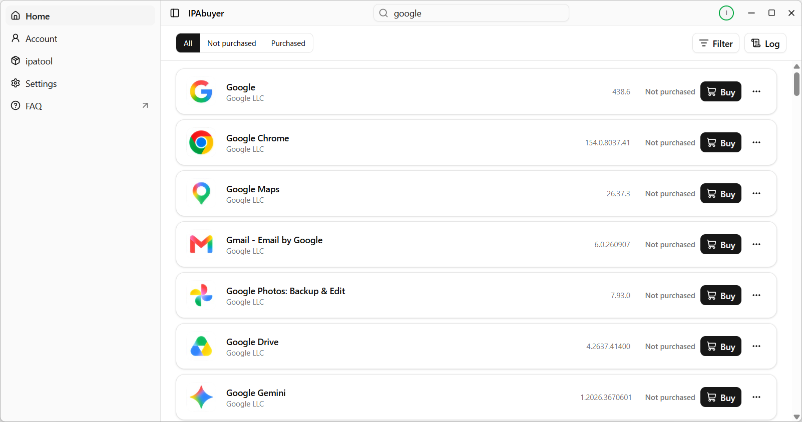

# IPAbuyer

[简体中文](README.md) | English

## Introduction

> [!TIP]
> For more information about the app, see the website: <https://ipabuyer.github.io/en/>

Buy apps from the App Store quickly with IPAbuyer!

IPAbuyer is a Windows desktop app that helps users browse, purchase (free apps only) and download apps from the App Store. Authentication, purchasing and downloading are handled by [ipatool](https://github.com/majd/ipatool).

## How to Download

## Screenshots

## Organization Repositories

- Current version (Tauri 2): [IPAbuyer.Rust](https://github.com/ipabuyer/IPAbuyer.Rust)
- Legacy version (WinUI 3): [IPAbuyer.WinUI](https://github.com/ipabuyer/IPAbuyer.WinUI)
- Website source: [ipabuyer.github.io](https://github.com/ipabuyer/ipabuyer.github.io)

## FAQ

See the FAQ on the website: <https://ipabuyer.github.io/en/faq.html>

## Acknowledgements

- [ipatool](https://github.com/majd/ipatool): the upstream project

## Copyright

Copyright © 2025-2026 IPAbuyer.

Released under the terms of the [GNU Affero General Public License v3.0](LICENSE).

The ipatool software included in this application remains under its original license.
