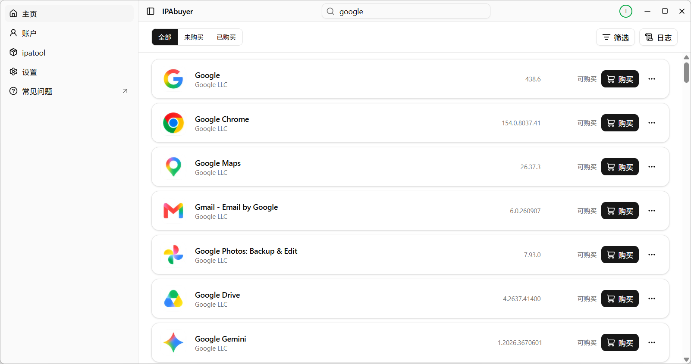

# IPAbuyer

简体中文 | [English](README.en.md)

## 软件介绍

> [!TIP]
> 更多软件信息，参见官网：<https://ipabuyer.github.io/>

使用 IPAbuyer，快速购买 App Store 中的应用！

IPAbuyer 是一款 Windows 桌面应用，帮助用户浏览、购买（仅限免费 App）并下载 App Store 中的应用，认证、购买与下载由 [ipatool](https://github.com/majd/ipatool) 完成。

## 如何下载

## 软件截图

## 组织仓库

- 现行版本（Tauri 2）：[IPAbuyer.Rust](https://github.com/ipabuyer/IPAbuyer.Rust)
- 旧版（WinUI 3）：[IPAbuyer.WinUI](https://github.com/ipabuyer/IPAbuyer.WinUI)
- 官网源码：[ipabuyer.github.io](https://github.com/ipabuyer/ipabuyer.github.io)

## 常见问题

请见官网 FAQ：<https://ipabuyer.github.io/faq.html>

## 致谢

- [ipatool](https://github.com/majd/ipatool)：上游软件

## 版权信息

Copyright © 2025-2026 IPAbuyer.

以 [GNU Affero General Public License v3.0](LICENSE) 的条款发布。

本软件中包含的 ipatool 软件遵守其原有的许可证。
